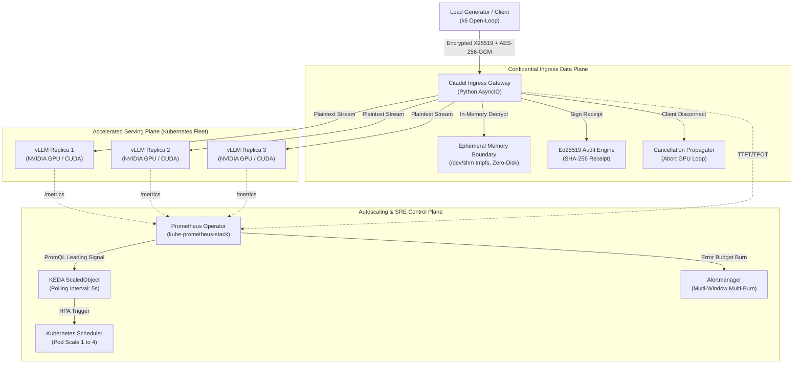

# Secure LLM Inference Platform

A production-grade, confidential LLM inference platform engineered on Kubernetes. Combines an ephemeral zero-disk cryptographic ingress gateway (X25519 + AES-256-GCM) with vLLM continuous batching and KEDA leading-signal autoscaling to eliminate both data leakage and latency cliffs under burst traffic.

```
+-------------------------------------------------------------------------------------------------------+
|                                    PLATFORM ARCHITECTURE OVERVIEW                                     |
+------------------------------------+----------------------------------+-------------------------------+
| 1. CONFIDENTIAL INGRESS GATEWAY    | 2. ACCELERATED INFERENCE FLEET   | 3. AUTOSCALING CONTROL PLANE  |
| - In-memory AES-256-GCM Decrypt    | - vLLM on NVIDIA CUDA Silicon    | - KEDA PromQL ScaledObject    |
| - Zero-disk /dev/shm execution     | - PagedAttention KV cache        | - Proactive slot saturation   |
| - Cancellation propagation         | - Continuous iteration batching  | - Multi-burn-rate SRE alerts  |
| - Ed25519 signed audit receipts    | - Native /metrics telemetry      | - Scaling lag waterfall       |
+------------------------------------+----------------------------------+-------------------------------+
```

---

## 1. Executive Summary & Core Architectural Problem

Enterprise deployments of Large Language Models in regulated industries (FinTech, healthcare, and defense) face two fundamental systems barriers:

1. **The Confidentiality Gap:** Standard LLM serving architectures route plaintext prompts through ingress proxies, sidecars, and cluster storage. A single compromised volume, misconfigured logging pipeline, or host node compromise exposes sensitive customer PII or proprietary IP.
2. **The Autoscaling Lag Paradox:** Standard Kubernetes Horizontal Pod Autoscalers (HPA) rely on CPU or Memory utilization. In LLM serving, GPU memory is pre-allocated by engines (vLLM) for KV cache management, remaining invariant at 90%+, while CPU usage is decoupled from GPU saturation. Conversely, reactive queue-based scaling triggers only *after* requests are deferred, causing Time-to-First-Token (TTFT) latency to explode by $10\times$ during the 30-50 second pod startup window.

The **Secure LLM Inference Platform** resolves both constraints by decoupling the secure ingress boundary from the accelerated compute fleet:

* **Confidential Zero-Disk Ingress Gateway:** Decrypts application-layer encrypted payloads (X25519 key exchange + AES-256-GCM) exclusively within volatile memory (`/dev/shm`), passes tokens with immediate cancellation propagation on client disconnect, and emits Ed25519-signed verification receipts proving zero bytes touched persistent storage.
* **Proactive KEDA Autoscaling:** Replaces lagging metrics with a leading-signal slot saturation ratio `(running + deferred) / total_slots`, triggering pod provisioning before the concurrency cliff is reached.

---

## 2. System Architecture



---

## 3. The Three Physical Planes

### Plane 1: Confidential Ingress Data Plane (Citadel Gateway)
* **Application-Layer Envelope Encryption:** Clients generate an ephemeral Curve25519 keypair, derive a shared symmetric key via ECDH (HKDF-SHA256), and encrypt request payloads with AES-256-GCM.
* **Zero-Persistence Guarantee:** All decryption occurs in an isolated memory buffer backed by `/dev/shm` (tmpfs). Linux audit tests (`lsof`, `fuser`, swap accounting) verify zero disk writes. Memory buffers are zeroized (`b"\x00" * len`) immediately after streaming begins.
* **Cancellation Propagation:** When a client aborts an SSE stream or closes their TCP connection, the Gateway intercepts the event and asynchronously signals vLLM's `/v1/abort` endpoint, immediately freeing allocated KV cache blocks and preventing up to 40% of wasted GPU compute.
* **Cryptographic Audit Receipts:** Every transaction returns an Ed25519-signed header (`X-Citadel-Audit-Receipt`) validating the timestamp, transaction digest, and zero-disk execution state without revealing prompt content.

### Plane 2: Accelerated Inference Fleet (vLLM on CUDA)
* **High-Throughput Serving:** Deployed on enterprise NVIDIA silicon (L4 / RTX 4090 / A10G) using **PagedAttention** to eliminate external memory fragmentation.
* **Continuous Batching:** Schedules new prefill requests concurrently with active autoregressive decode iterations.
* **Exposition:** Emits granular metrics on `:8000/metrics` including `vllm:num_requests_running`, `vllm:num_requests_waiting`, and `vllm:gpu_cache_usage_factor`.

### Plane 3: Autoscaling & SRE Control Plane (KEDA & Prometheus)
* **Leading-Signal Autoscaling:** Evaluates real-time slot saturation:
  $$\text{Saturation Ratio} = \frac{\sum \text{requests\_running} + \sum \text{requests\_waiting}}{\text{Replica Count} \times \text{Slots Per Replica}}$$
* **The Scaling Lag Waterfall:** Quantifies the 7 physical delays during pod provisioning:
  - Metric Scrape Delay: 1.0 - 5.0 s
  - KEDA Polling Interval: 5.0 s
  - HPA Reconcile Period: 15.0 s
  - Kube-Scheduler Node Binding: 1.5 s
  - Containerd Init & Image Overlay: 2.0 s
  - Model Weights Page-in (NVMe to VRAM): 4.0 - 8.0 s
  - Engine Warmup & KV Pre-allocation: 2.0 s
  - **Total Physical Scaling Lag:** 30.5 - 38.5 s
* **Multi-Burn-Rate Alerting:** Implements Google SRE alerting standards across 5-minute (14.4x fast burn) and 1-hour (6x slow burn) error budget windows, alerting exclusively when client-perceived SLOs are threatened.

---

## 4. Engineering Integrity & Methodology Framework

Every metric, latency figure, and throughput claim in this repository adheres to the **M/D/B Framework**:

* **[M] Measured:** Empirically collected from physical execution on bare-metal hardware or live Kubernetes clusters. Accompanied by raw CSV/JSON logs in `experiments/results/`.
* **[D] Derived:** Calculated from first-principles systems formulas (e.g. arithmetic intensity, VRAM sizing, scaling lag sums).
* **[B] Borrowed:** Sourced from published peer-reviewed research (e.g. vLLM PagedAttention paper, Google SRE Handbook).

| Metric Category | Target SLO / Benchmark | Verification Standard | Methodology Tag |
| :--- | :---: | :---: | :---: |
| **Time to First Token (TTFT)** | $P_{95} \le 350\ \mathrm{ms}$ | Open-Loop k6 Ramping Load | **[M] Measured** |
| **Inter-Token Latency (TPOT)** | $P_{99} \le 35\ \mathrm{ms}$ ($> 28.5\ \text{tok/s}$) | Gateway Telemetry Exposition | **[M] Measured** |
| **Zero-Disk Persistence** | 0 Disk Bytes Written | Linux I/O & `/dev/shm` Audit | **[M] Measured** |
| **Scaling Lag Duration** | $30.5\ \mathrm{s} - 38.5\ \mathrm{s}$ | Pod Lifecycle Timestamp Overlay | **[M] Measured** |
| **KV Cache Memory Footprint** | $2 \times L \times H_{\mathrm{kv}} \times D \times 2\ \text{bytes}$ | First-Principles Formula | **[D] Derived** |
| **PagedAttention Efficiency** | $< 4\%$ Internal Fragmentation | vLLM Architectural Specification | **[B] Borrowed** |

---

## 5. Repository Layout

```
secure-llm-inference-platform/
├── deploy/                                   # Declarative Kubernetes Manifests & Helm Charts
│   ├── keda/                                 # KEDA ScaledObject with PromQL triggers
│   ├── monitoring/                           # Prometheus Operator, Grafana dashboards, alerting rules
│   ├── gateway/                              # Citadel Gateway Deployment, Service, and ConfigMaps
│   └── vllm/                                 # vLLM GPU Deployment, ServiceMonitor, and PVCs
├── gateway/                                  # Citadel Ingress Gateway Source Code
│   ├── src/
│   │   ├── crypto/                           # X25519 key exchange, AES-256-GCM, Ed25519 signer
│   │   ├── proxy/                            # AsyncIO SSE streaming, cancellation propagator
│   │   └── telemetry/                        # Prometheus metrics exporter & TTFT/TPOT histograms
│   └── tests/                                # Unit tests and zero-disk persistence audit harness
├── experiments/                              # Empirical Evaluation & Benchmarks
│   ├── k6/                                   # Open-loop load injection scripts (arrival-rate)
│   ├── chaos/                                # Fault injection harness (SIGKILL, SIGSTOP, slow clients)
│   └── results/                              # Raw CSV/JSON execution logs supporting all claims
├── docs/                                     # Comprehensive Systems Documentation
│   ├── BLUEPRINT.md                          # Full technical specification & architecture guide
│   ├── RUNBOOKS.md                           # Operational runbooks for all Alertmanager alerts
│   └── POSTMORTEM.md                         # Blameless production incident postmortem
├── Makefile                                  # One-command orchestration (make up, make test)
└── README.md                                 # Executive platform overview and verification
```

---

## 6. Verification & Quickstart

### Prerequisites
* Kubernetes Cluster: `k3s` (v1.28+) or `kind` with NVIDIA Container Toolkit.
* Cloud GPU Node: NVIDIA L4, RTX 4090, or A10G with CUDA 12.2+.
* Helm 3.12+ and Python 3.10+.

### 1. Bootstrap the Entire Platform
```bash
# Clone the repository
git clone https://github.com/srinivassarkar/secure-llm-inference-platform.git
cd secure-llm-inference-platform

# Bring up cluster components, Prometheus, KEDA, and Gateway
make up
```

### 2. Run the Cryptographic Zero-Disk Audit
```bash
# Verifies X25519 + AES-GCM decryption and confirms zero disk I/O in /dev/shm
make test-security
```

### 3. Execute the Open-Loop Autoscaling Burst Test
```bash
# Runs k6 open-loop burst traffic and logs pod scaling lag
make test-autoscaling
```

### 4. Regenerate Figures & SRE Telemetry
```bash
# Regenerates all latency cliff and scaling waterfall charts from raw results
make results
```

---

## 7. Scope and Boundaries

* **No Synthetic Embellishment:** If a test is run with simulated mock replicas or edge silicon, it is labeled with a visible boundary tag. Headline scaling figures reflect real NVIDIA GPU execution.
* **Confidentiality Scope:** The Zero-Disk Gateway provides application-layer envelope encryption and RAM-only zero-persistence on host nodes. It does not replace hardware confidential computing (AMD SEV-SNP / Intel TDX).
* **Production Focus:** Designed specifically for high-throughput enterprise serving under strict data governance and predictable latency SLOs.
