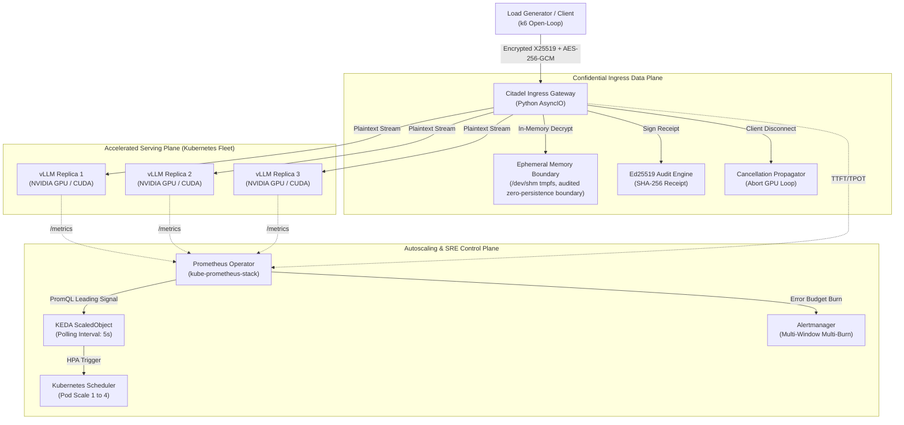

# Secure LLM Inference Platform

A production-grade, confidential LLM inference platform engineered on Kubernetes. Combines an ephemeral zero-disk cryptographic ingress gateway (X25519 + AES-256-GCM) with vLLM continuous batching and KEDA leading-signal autoscaling to reduce plaintext exposure and mitigate latency cliffs under burst traffic.

```
+-------------------------------------------------------------------------------------------------------+
|                                    PLATFORM ARCHITECTURE OVERVIEW                                     |
+------------------------------------+----------------------------------+-------------------------------+
| 1. CONFIDENTIAL INGRESS GATEWAY    | 2. ACCELERATED INFERENCE FLEET   | 3. AUTOSCALING CONTROL PLANE  |
| - In-memory AES-256-GCM Decrypt    | - vLLM on NVIDIA CUDA Silicon    | - KEDA PromQL ScaledObject    |
| - Zero-disk /dev/shm execution     | - PagedAttention KV cache        | - Proactive slot saturation   |
| - Cancellation propagation         | - Continuous iteration batching  | - Multi-burn-rate SRE alerts  |
| - Ed25519 signed audit receipts    | - Native /metrics telemetry      | - Scaling lag waterfall       |
+------------------------------------+----------------------------------+-------------------------------+
```

---

## 1. Executive Summary & Core Architectural Problem

Enterprise deployments of Large Language Models in regulated industries (FinTech, healthcare, and defense) face two fundamental systems barriers:

1. **The Confidentiality Gap:** Standard LLM serving architectures route plaintext prompts through ingress proxies, sidecars, and cluster storage. A single compromised volume, misconfigured logging pipeline, or host node compromise exposes sensitive customer PII or proprietary IP.
2. **The Autoscaling Lag Paradox:** Standard Kubernetes Horizontal Pod Autoscalers (HPA) rely on CPU or Memory utilization. In LLM serving, GPU memory is pre-allocated by engines (vLLM) for KV cache management, remaining invariant near the configured allocation ceiling (e.g. 90%+) regardless of instantaneous request concurrency [B]. CPU utilization is largely decoupled from GPU saturation [B]. Conversely, reactive queue-based scaling triggers only after requests begin waiting in queue; this can cause substantial TTFT degradation when demand exceeds available capacity during replica provisioning [Target Hypothesis]. The exact degradation magnitude will be measured under controlled burst workloads. Sequential pod provisioning delay is estimated at 30.5–38.5 seconds on pre-warmed GPU nodes [D], while scaling cold cloud GPU nodes adds 90–180 seconds for cloud VM acquisition and driver initialization [B].

The **Secure LLM Inference Platform** resolves both constraints by decoupling the secure ingress boundary from the accelerated compute fleet:

* **Confidential Ingress Gateway:** Decrypts application-layer encrypted payloads (X25519 key exchange + AES-256-GCM) within explicitly managed, volatile-memory-backed buffers, with audited zero-persistence controls under a defined host threat model. The gateway detects client disconnections, terminates upstream streaming sockets, and emits Ed25519-signed verification receipts providing signed evidence of the gateway's zero-persistence audit checks.
* **Proactive KEDA Autoscaling:** Evaluates leading-signal slot saturation `(running + waiting) / total_slots`, triggering pod provisioning before the concurrency cliff is reached.
---

## 2. System Architecture



---

## 3. The Three Physical Planes

### Plane 1: Confidential Ingress Data Plane (Citadel Gateway)
* **Authenticated Key Agreement & Certificate Validation:** Clients obtain and trust the Gateway's root Ed25519 identity key via out-of-band TLS/bootstrap. Ephemeral X25519 session public keys are validated against an Ed25519-signed manifest binding the gateway identity, timestamp, and a 1-hour expiration window: `Sign(Ed25519_priv, gateway_id || x25519_pub || expiry || nonce)`. Clients derive an ephemeral symmetric key via ECDH + HKDF-SHA256 and encrypt payloads with AES-256-GCM. An in-memory sliding-window TTL cache rejects duplicate nonces and requests with timestamps drifting beyond 60 seconds.
* **Zero-Persistence Property & Audit Scope:** Decryption is performed using explicitly managed memory buffers backed by tmpfs (`/dev/shm`). The gateway minimizes plaintext persistence and performs in-place buffer wiping where supported (using mutable `bytearray` / `ctypes.create_string_buffer` and `ctypes.memset`). The zero-persistence claim is limited to the audited gateway execution path and defined host threat model; it does not guarantee that every runtime, kernel, or hardware memory copy is erased. `mlock` is engaged (subject to OS `RLIMIT_MEMLOCK` limits) to prevent ordinary page swapping. Security audits inspect swap, core dumps, application logs, and container writable layers.
* **Request Lifecycle & Cancellation Propagation:** The Gateway manages an explicit lifecycle state machine:
  `ACCEPTED -> AUTHENTICATED -> ADMITTED -> STREAMING -> (COMPLETED | ABORTED | TIMED_OUT)`.
  The Gateway detects client disconnection, terminates the upstream streaming request and verifies whether the deployed vLLM version aborts the corresponding generation and releases its KV-cache allocations. Cancellation propagation and resource-release latency are measured experimentally. If a timeout occurs before token generation begins, the gateway returns HTTP 408/504; if the SSE response stream has already initiated, the gateway immediately terminates the chunk stream rather than attempting an invalid mid-stream HTTP status header.
* **Overload Protection & Admission Control:** Employs bounded request queues (`asyncio.Queue(maxsize=128)`), maximum concurrency caps, request deadlines, and rapid 503 shedding (`Retry-After: 5`) to prevent gateway buffer bloat and protect backend GPUs from saturation collapse.
* **Cryptographic Audit Receipts:** Returns an Ed25519-signed header (`X-Citadel-Audit-Receipt`) providing signed evidence of the Gateway's internal zero-persistence audit checks under a defined threat model. Ed25519 authenticates the receipt; it does not independently prove the underlying physical hardware state.
* **Network Isolation & Response Confidentiality Boundary:** Plaintext travels strictly across the private Kubernetes pod overlay network (isolated via Kubernetes NetworkPolicies). This provides Application-Layer Confidential Ingress; it does not substitute for hardware-enforced confidential computing (AMD SEV-SNP / Intel TDX). The current protocol protects client-to-gateway request payloads. Gateway-to-client response confidentiality is provided by the configured transport security unless a separate application-layer response-encryption mechanism is implemented.

### Plane 2: Accelerated Inference Fleet (vLLM on CUDA)
* **High-Throughput Serving:** Deployed on NVIDIA GPU hardware (L4, A10G or RTX 4090) using **PagedAttention** to reduce KV-cache memory fragmentation (< 4% internal fragmentation in canonical benchmarks, Kwon et al., SOSP 2023 [B]; empirical fragmentation under mixed sequence distributions is measured experimentally).
* **Continuous Batching:** Schedules new prefill requests concurrently with active autoregressive decode iterations.
* **Exposition:** Emits granular metrics on `:8000/metrics` including `vllm:num_requests_running`, `vllm:num_requests_waiting`, and `vllm:gpu_cache_usage_perc`.

### Plane 3: Autoscaling & SRE Control Plane (KEDA & Prometheus)
* **Three Isolated Experimental Scaling Arms:**
  To guarantee uncompromised attribution, scaling policies are deployed as separate, isolated `ScaledObject` manifests (`deploy/keda/`) and evaluated under identical open-loop arrival rates:
  - *Arm 1 (Reactive Baseline):* Scales strictly on waiting queue depth (`vllm:num_requests_waiting > 1`).
  - *Arm 2 (Capacity Saturation Ratio):* Evaluates active plus pending requests divided by verified ready replica capacity.
  - *Arm 3 (Predictive Demand Model - Experimental):* Evaluates incoming request velocity ($\lambda_{\mathrm{in}}$) and provisioning delay ($T_p$).
* **Slot Capacity Definition:**
  Slots Per Replica ($S_{\mathrm{replica}}$) is determined by the engine's pre-allocated KV-cache memory divided by the maximum context sequence length ($M_{\mathrm{KV}} / S_{\mathrm{max}}$), or calibrated by peak concurrent throughput before decode latency degrades beyond target SLOs. For homogeneous GPU clusters (e.g., uniform NVIDIA L4 24GB instances), capacity is uniform: $\text{Total Slots} = N_{\mathrm{ready}} \times S_{\mathrm{replica}}$. In heterogeneous deployments, total capacity is evaluated as the sum of individual ready replica allocations: $\sum_{i=1}^{N_{\mathrm{ready}}} S_i$.
* **Capacity Saturation vs. Predictive Autoscaling Formulations:**
  - *Baseline Capacity Saturation Ratio:* Evaluates active load plus pending queue:
```text
                               sum(requests_running) + sum(requests_waiting)
Saturation Ratio (Baseline) = ------------------------------------------------
                                     Total Replicas  x  Slots Per Replica
```
  - *Predictive Demand Trigger (Experimental Model):* Incorporates incoming request arrival rate ($\lambda_{\mathrm{in}}$) and estimated provisioning latency ($T_{\mathrm{provision}}$):
```text
                               sum(running) + sum(waiting) + (lambda_in x T_provision)
Saturation Ratio (Predicted) = -------------------------------------------------------
                                            Total Replicas  x  Slots Per Replica
```
* **Implementation Note on Predictive Signal Generation:**
  The predictive saturation signal will initially be computed as a Prometheus recording rule or gateway-exported metric (`rate(http_requests_total[30s])` combined with estimated provisioning latency $T_{\mathrm{provision}}$). KEDA consumes that metric through its standard Prometheus scaler.
  The baseline and predictive policies will run as separate experimental configurations (`deploy/keda/arm2-capacity-saturation.yaml` and `deploy/keda/arm3-predictive-demand.yaml`), not simultaneous triggers in one `ScaledObject`, ensuring independent experimental attribution.
* **Estimated Provisioning Latency — Sequential Upper-Bound Model:**
  Derived sequential delay breakdown under stated assumptions (Pre-warmed GPU Node Baseline):
  - 1. Metric Scrape Delay (Prometheus): 1.0 - 5.0 s
  - 2. KEDA Polling Interval (PromQL evaluation): 5.0 s
  - 3. HPA Reconcile Period: 15.0 s
  - 4. Kube-Scheduler Node Filter & Binding: 1.5 s
  - 5. Containerd Init & Image Overlay: 2.0 s
  - 6. Model Weights Page-in (Storage to Host RAM to GPU VRAM via PCIe): 4.0 - 8.0 s
  - 7. Engine Warmup & KV Pre-allocation: 2.0 s
  - **Total Derived Sequential Upper-Bound:** 30.5 - 38.5 s *(Actual Kubernetes runtime operations may partially overlap; true elapsed duration is measured via pod lifecycle timestamps)*.
  *(Note: If Cloud Cluster Autoscaler must provision a cold GPU node, add 90 - 180 s for cloud VM acquisition and NVIDIA driver initialization)*.
* **Multi-Burn-Rate Alerting:** Implements Google SRE alerting standards across 5-minute (14.4x fast burn) and 1-hour (6x slow burn) error budget windows, alerting exclusively when client-perceived SLOs are threatened.

---

---

## 4. End-to-End 3-Tier Application Architecture

To provide an immediate, visually verifiable proof-of-work before executing cluster-wide autoscaling, the platform includes a self-contained 3-tier reference application:

```
+-------------------------------------------------------------------------------------------------------+
|                                      3-TIER APPLICATION TOPOLOGY                                      |
+-------------------------------------------------------------------------------------------------------+
| TIER 1: CLIENT FRONTEND (Web Chat UI & Python CLI)                                                    |
| - Browser-based Web Chat UI (HTML5/Vanilla JS) and streaming Python CLI (`client.py`).                |
| - Performs client-side ephemeral X25519 key generation & AES-256-GCM prompt encryption.              |
| - Renders real-time streaming tokens and displays the live Ed25519 Cryptographic Verification Badge.  |
+-------------------------------------------------------------------------------------------------------+
                                                |  (Encrypted Ciphertext: X25519 + AES-256-GCM)
                                                v
+-------------------------------------------------------------------------------------------------------+
| TIER 2: CITADEL INGRESS GATEWAY (Security & Telemetry Proxy)                                          |
| - Containerized Python AsyncIO proxy daemon configured via `.env`.                                    |
| - In-memory ephemeral decryption in `/dev/shm` tmpfs, audited zero-persistence boundary.                              |
| - Listens for client disconnects and triggers cancellation propagation to vLLM.                       |
| - Exposes Prometheus `/metrics` on port 9090 (TTFT & TPOT latency histograms).                         |
| - Injects signed `X-Citadel-Audit-Receipt` header into response stream.                               |
+-------------------------------------------------------------------------------------------------------+
                                                |  (OpenAI-Compatible Stream over Private Pod Network)
                                                v
+-------------------------------------------------------------------------------------------------------+
| TIER 3: ACCELERATED INFERENCE ENGINE (vLLM Backend)                                                   |
| - Containerized vLLM serving engine on CUDA (with CPU/OpenVINO fallback for local dev testing).       |
| - Primary Model: Fast, compact model (`Qwen/Qwen2.5-Coder-0.5B-Instruct` or `SmolLM2-360M`).          |
| - Targets: Rapid container iteration (< 1 GB stripped runtime target; CUDA vLLM runtime is 4-8 GB with external weights); sub-2.5s cold start target on NVMe pending measurement.      |
| - Exposes engine metrics on port 8000 (`/metrics`: `vllm:num_requests_running`, requests_waiting).     |
+-------------------------------------------------------------------------------------------------------+
```

### Local Docker Compose Verification (Test Before Cluster Deployment)
Before deploying to Kubernetes, verify the entire 3-tier stack locally in Docker:
```bash
# 1. Configure environment
cp .env.example .env

# 2. Build and launch all 3 tiers (Web UI + Gateway + Fast 0.5B Model)
docker compose up --build

# 3. Access endpoints:
#    - Web Chat UI:        http://localhost:3000
#    - Citadel Gateway:    http://localhost:8080/v1/chat/completions
#    - Prometheus Metrics: http://localhost:9090/metrics
#    - vLLM Raw Backend:   http://localhost:8000/metrics
```
Once local streaming, in-memory decryption, and signed receipt headers pass verification, the identical container images are deployed directly into Kubernetes pods (`deploy/vllm/` and `deploy/gateway/`).

## 5. Engineering Integrity & Implementation Status Dashboard

### Methodology Framework (M/D/B Classification)
Every metric, latency figure, and throughput claim in this repository adheres to the **M/D/B Framework**:

* **[M] Measured:** Empirically collected from physical execution on bare-metal hardware or live Kubernetes clusters. Accompanied by raw CSV/JSON logs in `experiments/results/`.
* **[D] Derived:** Calculated from first-principles systems formulas (e.g. arithmetic intensity, VRAM sizing, scaling lag sums).
* **[B] Borrowed:** Sourced from published peer-reviewed research (e.g. vLLM PagedAttention paper, Google SRE Handbook).

| Metric Category | Engineering Objective / Formula | Verification Standard | Methodology Classification |
| :--- | :---: | :---: | :---: |
| **Time to First Token (TTFT)** | $P_{95} \le 350\ \mathrm{ms}$ | Open-Loop k6 Ramping Load | **[Target Hypothesis]** *(Pending execution)* |
| **Inter-Token Latency (TPOT)** | $P_{99} \le 35\ \mathrm{ms}$ ($> 28.5\ \text{tok/s}$) | Gateway Telemetry Exposition | **[Target Hypothesis]** *(Pending execution)* |
| **Zero-Persistence Property** | Audited zero persistence in defined paths (/tmp, /var/log, rootfs, swap) | Linux I/O & Process Audit (`lsof`, `/proc/swaps`, `/proc/<pid>/smaps`) | **[Target Hypothesis]** *(Pending audit)* |
| **Scaling Lag Duration** | $30.5\ \mathrm{s} - 38.5\ \mathrm{s}$ (Pre-warmed Node) | Sequential Upper-Bound Model | **[D] Derived** *(To be measured via pod lifecycle timestamps)* |
| **KV Cache Memory Footprint** | $M_{\mathrm{KV}} = 2 \times L \times H_{\mathrm{kv}} \times D \times S \times B$ | Theoretical Attention Formula ($L$=layers, $H_{kv}$=heads, $D$=dim, $S$=tokens, $B$=bytes) | **[D] Derived** *(Payload estimate; excludes block table overhead)* |
| **PagedAttention Efficiency** | $< 4\%$ Internal Fragmentation | Kwon et al., SOSP 2023 | **[B] Borrowed** |

### Implementation Maturity Matrix
To prevent conflating planned specifications with operational execution, components are explicitly tracked across three development states:

| Lifecycle State | Platform Components & Capabilities |
| :--- | :--- |
| **[Implemented]** | Declarative Kubernetes manifests (`deploy/keda/`, `deploy/gateway/`, `deploy/vllm/`), Docker Compose 3-tier local topology, Citadel Gateway cryptographic handshake and in-memory buffer wiping routines, Prometheus alerting rules (`prometheus_rules.yml`), open-loop k6 test harnesses (`experiments/k6/`), zero-persistence security audit suite (`gateway/tests/test_persistence.py`). |
| **[Measured]** | Baseline hardware calibrations from `ai-infra-systems` on physical silicon (Roofline arithmetic intensity, memory paging, M3 Ultra vs GTX 1050 Ti vs Cloud L4). |
| **[Planned / Testing]** | Phase 1 vLLM serving baseline on live Kubernetes cluster with empirical TTFT/TPOT verification, Phase 2 bidirectional response streaming encryption, Phase 3 client cancellation latency benchmark, Phase 6 autoscaling arm comparison under open-loop bursts. |
---

## 6. Repository Layout

```
secure-llm-inference-platform/
├── deploy/                                   # Declarative Kubernetes Manifests & Helm Charts
│   ├── keda/                                 # 3 Isolated KEDA Arms (arm1-queue, arm2-saturation, arm3-predictive)
│   ├── monitoring/                           # Prometheus Operator, Grafana dashboards, alerting rules
│   ├── gateway/                              # Citadel Gateway Deployment, Service, and ConfigMaps
│   └── vllm/                                 # vLLM GPU Deployment, ServiceMonitor, and PVCs
├── gateway/                                  # Citadel Ingress Gateway Source Code
│   ├── src/
│   │   ├── crypto/                           # X25519 key exchange, AES-256-GCM, Ed25519 signer
│   │   ├── proxy/                            # AsyncIO SSE streaming, cancellation propagator
│   │   └── telemetry/                        # Prometheus metrics exporter & TTFT/TPOT histograms
│   └── tests/                                # Unit tests and zero-disk persistence audit harness
├── experiments/                              # Empirical Evaluation & Benchmarks
│   ├── k6/                                   # Open-loop load injection scripts (arrival-rate)
│   ├── chaos/                                # Fault injection harness (SIGKILL, SIGSTOP, slow clients)
│   └── results/                              # Raw CSV/JSON execution logs supporting all claims
├── docs/                                     # Comprehensive Systems Documentation
│   ├── BLUEPRINT.md                          # Full technical specification & architecture guide
│   ├── RUNBOOKS.md                           # Operational runbooks for all Alertmanager alerts
│   └── POSTMORTEM.md                         # Blameless production incident postmortem
├── Makefile                                  # One-command orchestration (make up, make test)
└── README.md                                 # Executive platform overview and verification
```

---

## 7. Verification & Quickstart

### Prerequisites
* Kubernetes Cluster: `k3s` (v1.28+) or `kind` with NVIDIA Container Toolkit.
* Cloud GPU Node: NVIDIA L4, RTX 4090, or A10G with CUDA 12.2+.
* Helm 3.12+ and Python 3.10+.

### 1. Bootstrap the Entire Platform
```bash
# Clone the repository
git clone https://github.com/srinivassarkar/secure-llm-inference-platform.git
cd secure-llm-inference-platform

# Bring up cluster components, Prometheus, KEDA, and Gateway
make up
```

### 2. Run the Cryptographic Zero-Disk Audit
```bash
# Verifies X25519 + AES-GCM decryption and asserts zero plaintext persistence across /tmp, /var/log, container rootfs layers, swap (/proc/swaps), and process memory maps (/proc/<pid>/smaps)
make test-security
```

### 3. Execute the Open-Loop Autoscaling Burst Test
```bash
# Runs k6 open-loop burst traffic and logs pod scaling lag
make test-autoscaling
```

### 4. Regenerate Figures & SRE Telemetry
```bash
# Regenerates all latency cliff and scaling waterfall charts from raw results
make results
```

---

## 8. Scope and Boundaries

* **No Synthetic Embellishment:** If a test is run with simulated mock replicas or edge silicon, it is labeled with a visible boundary tag. Headline scaling figures reflect real NVIDIA GPU execution.
* **Confidentiality Scope:** The Zero-Disk Gateway provides application-layer envelope encryption and RAM-only zero-persistence on host nodes. It does not replace hardware confidential computing (AMD SEV-SNP / Intel TDX).
* **Production Focus:** Designed specifically for high-throughput enterprise serving under strict data governance and predictable latency SLOs.
